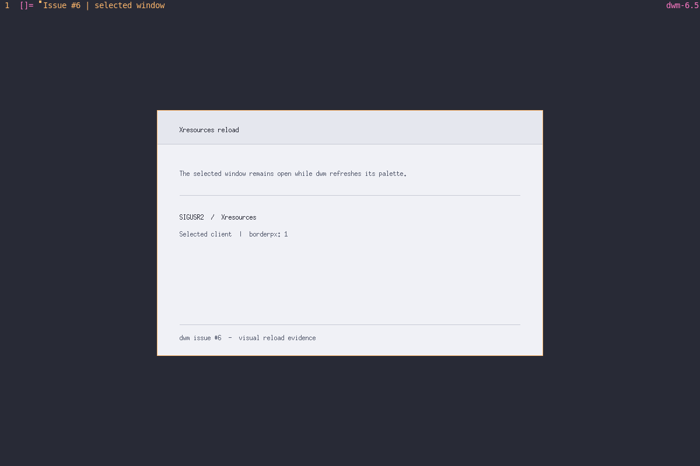
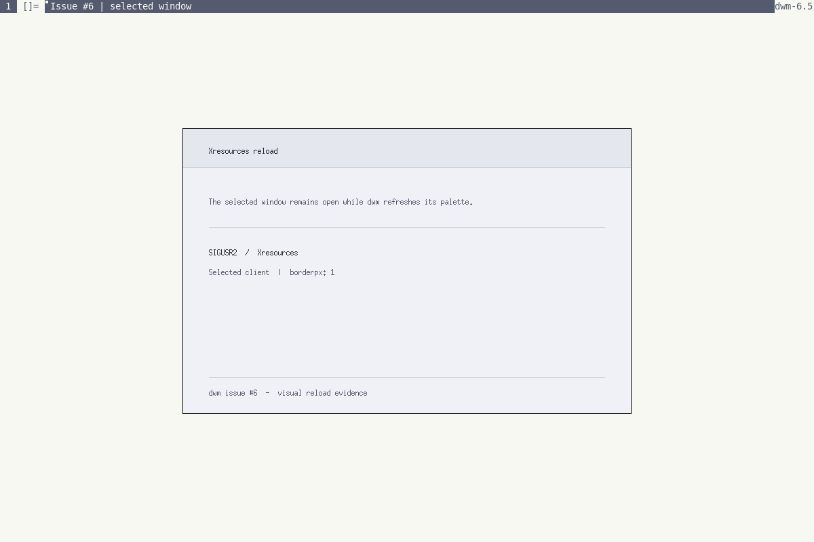

# Issue #6 visual evidence

Both screenshots were captured from one 1200x800 Xvfb session using the project's X11 integration build of dwm. The same selected client and dwm process remained alive while the Xresources palette changed and SIGUSR2 was sent. The test checked focus, a one-pixel window border, and rendered border pixels before and after the reload.

## Dark theme

Xresources: `dwm.selbordercolor: #ffb86c`, `dwm.borderpx: 1`.

## Light theme

Xresources: `dwm.color0: #f8f8f2`, `dwm.color4: #555b6e`, `dwm.selbordercolor: #000000`, `dwm.borderpx: 1`.

